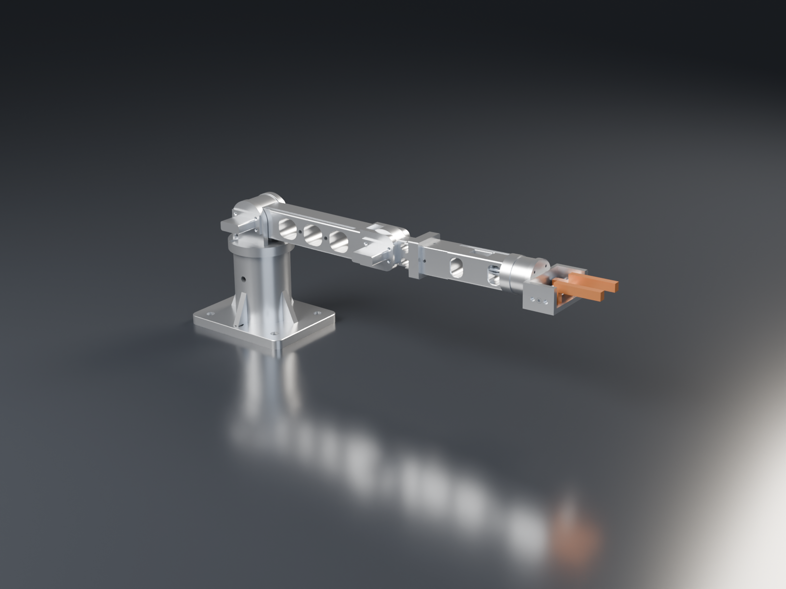

# 四轴机械臂 + 丝杆驱动平行夹爪



个人自主设计并建模的四轴桌面机械臂，末端为丝杆驱动的平行夹爪。从几何建模到最终渲染由我自己完成，用途是结构与装配练习。

**这是概念设计，不是可制造的产品图纸。** 没有做载荷计算、公差配合、电机选型，详见文末「已知局限」。

## 结构

| 部件 | 说明 |
|---|---|
| 底座 | 方形底板 + 四角安装孔 + 立柱法兰，立柱四周有三角加强筋 |
| 腰关节 | 绕竖直轴回转，驱动形式未定 |
| 大臂 | 长梁结构，侧面开三个圆形减重孔，末端带方槽 |
| 肘关节 | 转向关节，含关节壳与连接法兰 |
| 小臂 | 短梁，带圆孔与槽，连接腕部支架 |
| 夹爪 | 丝杆驱动，双指平行开合，钳口为橙色，两侧为导轨支架 |

## 工具链

```
CadQuery（Python 参数化） → STEP 装配体 → Blender 5.3 → Cycles 渲染
                                          （RTX 5060 Laptop，CUDA + OptiX）
```

选参数化建模的原因：底座尺寸、臂长、关节间距都是变量，改一处，整条几何链自动重建，不用手工重画。这个模型共 22 个部件。

## 文件

- `cad/ARM_4DOF_SCREW_CLAW_mid.step` — 完整装配体，可直接导入 SolidWorks / Fusion 360 / FreeCAD
- `blender/arm_4dof_screw_claw_mid.blend` — 渲染场景，含三种材质、三点布光与相机
- `images/hero.png` — 整机渲染
- `images/detail.png` — 夹爪局部

## 已知局限

- 未做载荷与刚度计算，大臂减重孔的位置是经验布置，没有拓扑优化依据
- 未定义公差与配合，STEP 中是公称几何，不满足加工要求
- 未做电机与减速比选型，关节驱动形式留空
- 丝杆夹爪只验证了运动可行，没算夹持力与自锁条件

这四条是下一版要补的，不是缺陷免责声明。

## 许可

CC BY-NC 4.0
